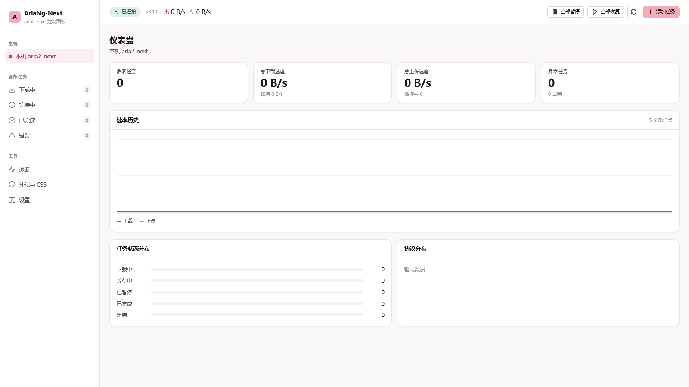
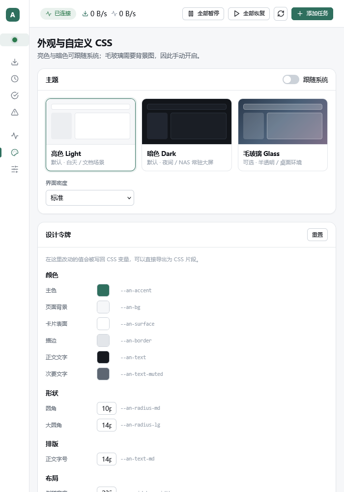

<div align="center">

# AriaNg-Next

**面向 aria2-next 的 Web 控制面板**

多协议 · 自定义外观 · 纯静态部署

[快速开始](#快速开始) · [功能](#功能) · [文档](docs/README.md) · [许可](#许可)

</div>

---

## 简介

AriaNg 是 aria2 最知名的 Web 前端，但它停在 2014–2018 年的技术栈上，
界面里「所有东西长得一样」，外观也写死了 —— 想改只能 fork。

AriaNg-Next 保留 AriaNg 全部核心操作路径（多主机、任务分组、排序筛选、详情、选项编辑、通知），
重新设计信息层级与视觉语言，并把它升级为**可编程的外观**。

<p align="center">
  
</p>

---

## 功能

### 保留 AriaNg 的核心能力

多 RPC 主机 · 增量轮询 · 任务分组（下载中/等待中/已完成/错误）· 排序与搜索 ·
文件树与 BT peer/tracker 详情 · 全局选项与每目录选项 · 下载完成通知 ·
多语言 · 设置导入导出 · URL 命令行 API · **纯静态部署，不需要运行时**

### 重新设计的界面

| | |
|---|---|
| **信息分层** | 顶部常驻全局状态 → 中部任务流 → 右侧详情抽屉，详情不再离开列表 |
| **双模列表** | 表格 / 卡片随时切换，移动端自动切卡片 |
| **三套主题** | 亮色 / 暗色 / 毛玻璃，暖中性底色 + 品牌色阴影 |
| **响应式** | 桌面三栏 → 平板两栏 → 手机底部标签栏 |

### 面向 aria2-next 的扩展

| 能力 | 说明 |
|---|---|
| **能力探测** | 启动时问后端到底支持什么，不支持的能力**显式标灰**而不是静默消失 |
| **多协议** | HTTP / HTTPS / BitTorrent（种子 + 磁力）/ **ED2K** / Metalink / **HLS** / **DASH** |
| **多主机** | 同时连接多台 aria2-next，一键切换；各主机任务数据完全隔离 |
| **媒体任务** | 按呈现时长计算进度、清晰度轨道、直播录制状态 |
| **诊断面板** | 磁盘队列、协议开销、tracker 状态、性能警告 |

> 上面每种协议都在**真实的 aria2-next 实例**上跑过完整下载，结论与限制见
> [实测报告](docs/VERIFICATION.md)。
> 顺带一提：SFTP 虽然出现在 aria2-next 的 `enabledFeatures` 里，
> 但实测 `addUri` 会直接拒绝 `sftp://` URI —— **能力探测列表不等于实际可用**。

### 自定义外观（核心特性）



**不改源码、不 fork，也能把面板改成自己顺眼的样子。**

- 内置**设计令牌编辑器**：主色、圆角、字号、侧栏宽度拖一下就变，实时预览
- 内置**自定义 CSS 编辑器**：写完即生效，语法错误会保留上一份可用样式并标出行号
- **作用域可选**：只作用于面板容器内，或全局生效
- **可导出分享**：一份 `.css` 文件带走你的整套外观
- 用户的 CSS **永远覆盖**组件样式 —— 靠 CSS `@layer` 保证，不靠 `!important`

详见 **[自定义 CSS 指南](docs/CUSTOM-CSS.md)**。

---

## 快速开始

```bash
npm install
npm run dev        # 开发服务器 http://localhost:5173
```

构建产物是**纯静态文件**：

```bash
npm run build      # 产物在 dist/
```

`dist/` 可以直接丢进任意静态服务器、Nginx、Caddy 或 Docker 镜像。
用的是 hash 路由（`/#/tasks`），不需要服务器配合 rewrite 规则。

<details>
<summary>Docker 部署示例</summary>

```dockerfile
FROM nginx:alpine
COPY dist/ /usr/share/nginx/html/
EXPOSE 80
```

```bash
docker build -t ariang-next .
docker run -d -p 8080:80 --name ariang-next ariang-next
```

</details>

---

## 连接到 aria2-next

启动 aria2-next 的 RPC 服务：

```bash
aria2-next --enable-rpc --rpc-listen-port=6800 --rpc-listen-all=false --rpc-secret=your-token
```

在面板的「设置 → RPC 主机」里填写：

| 字段 | 值 |
|---|---|
| RPC 地址 | `ws://127.0.0.1:6800/jsonrpc` |
| RPC 密钥 | `your-token`（对应 `--rpc-secret`） |

> 推荐用 `ws://` / `wss://`：浏览器对 HTTP 请求会做 CORS 检查，而 aria2-next 的 HTTP 端点
> 默认不带 CORS 响应头；WebSocket 不受此限制。

**没有 aria2 服务也能开发界面** —— 仓库里带了一个模拟服务器：

```bash
node tools/mock-aria2.mjs    # 监听 6801，面板填 ws://127.0.0.1:6801/jsonrpc
```

---

## 文档

| 文档 | 内容 |
|---|---|
| [docs/LEARNING.md](docs/LEARNING.md) | **学习路线** —— 从零读懂这个前端项目的八个步骤 |
| [docs/ARCHITECTURE.md](docs/ARCHITECTURE.md) | 架构说明 —— core/ui 分层、数据流、扩展指引 |
| [docs/CUSTOM-CSS.md](docs/CUSTOM-CSS.md) | 自定义 CSS 与设计令牌 |
| [docs/DEVELOPMENT.md](docs/DEVELOPMENT.md) | 开发环境、工具链、联调、FAQ |
| [docs/design/wireframe-v0.1.html](docs/design/wireframe-v0.1.html) | 结构线框稿 |
| [docs/verification/](docs/verification/) | 真实浏览器渲染的视觉验证产物 |

---

## 贡献

欢迎提 Issue 和 PR。改动前请先跑一遍：

```bash
npm run typecheck && npm test
```

代码风格与现有代码保持一致，**注释用中文**（本项目把代码本身当教材）。

---

## 许可

[MIT](LICENSE) © AriaNg-Next contributors

---

<p align="center">
  <sub>基于 <a href="https://github.com/AnInsomniacy/aria2-next">aria2-next</a> 构建 ·
  交互与核心逻辑参考 <a href="https://github.com/mayswind/AriaNg">AriaNg</a></sub>
</p>
